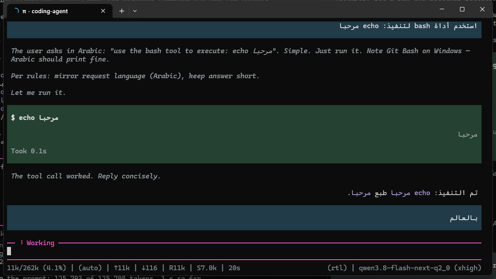

# Pi with Arabic and Persian rendering

This fork of [pi](https://github.com/earendil-works/pi) adds bidirectional rendering to the
terminal UI: right-to-left text is painted in visual order, and a line is placed against the
edge it reads from. Everything else about pi is upstream.



## Why this exists

Windows Terminal paints cells in the order the program writes them. It does not implement the
Unicode Bidirectional Algorithm (UAX #9), so text kept in **logical** order - the order every
editor, clipboard and model keeps it in - appears mirrored: `مرحبا` written cell by cell left to
right reads backwards. Only the string written to the screen changes. Caret offsets, selection,
copy, search, wrapping and every column calculation stay logical.

## What you get

- **Glyph order.** `reorderLine()` turns one rendered line from logical order into visual order
  using UAX #9 embedding levels, working on grapheme clusters so an Arabic letter and its
  combining marks travel as one cell. Brackets are mirrored. Indentation and padding stay put.
- **Smart direction.** A line that opens in Arabic or Hebrew reads right to left. A line that
  opens in Latin reads right to left only when RTL words outnumber Latin ones, so a tool name,
  a path or a list marker at the start of a line does not flip an Arabic sentence:
  `ask 3 questions (أي بريد يكتب في الـ commit؟)` stays Arabic.
- **Edge alignment.** With `terminal.rtl.align` on, Arabic lines hug the right edge, English
  stays left, and list markers, blockquote bars and table columns follow the same edge, so
  `- عنصر` has its bullet on the right and an RTL table has its first logical column on the right.
- **The prompt.** The caret travels with the text it precedes, and the arrow keys step through
  an Arabic word in visual order while the buffer stays logical.
- **English is untouched.** A line with no strong RTL character returns byte for byte, so
  nothing changes for left-to-right users.

## Turn it on

```json
{
  "terminal": {
    "rtl": { "enabled": true, "align": true }
  }
}
```

- `terminal.rtl.enabled` defaults to `false` in the CLI: RTL rendering is off until you turn it
  on, either in `settings.json` or from the settings menu (Terminal → RTL).
- `terminal.rtl.align` defaults to `true` and only has an effect once reordering is on.
- `PI_RTL=0` turns reordering off regardless of settings.

## Use the patch on the pi you already have

You do not need this fork running to get RTL rendering. `rtl-patch/` ships the patch and two
Windows scripts:

```
rtl-patch\rtl-apply-installed.bat   applies it to the pi already installed from npm
rtl-patch\rtl-apply-latest.bat      clones the newest upstream tag, applies the patch, runs the bidi tests
```

`rtl-patch/pi-rtl-bidi.patch` is the whole diff from upstream `v1.4.0` to this branch: 24 files,
+1550 / -35. Apply it to a clean checkout with `git apply pi-rtl-bidi.patch`. See
`rtl-patch/README.md` for both paths in detail.

## Run this fork from source

```sh
git clone https://github.com/AliQaseef/pi-rtl-bidi
cd pi-rtl-bidi
npm install --ignore-scripts
./pi-test.sh
```

## Tests

The bidi work is covered by `packages/tui/test/bidi.test.ts` (engine, including a check against
`bidi-js`'s own UAX #9 reordering), `bidi-markdown.test.ts`, `bidi-text.test.ts`,
`bidi-editor.test.ts` (caret and arrow keys through the virtual terminal) and
`packages/coding-agent/test/rtl-settings.test.ts` (settings wiring).

```sh
node "$(git rev-parse --show-toplevel)/node_modules/vitest/dist/cli.js" --run packages/tui/test/bidi.test.ts
```

## Read more

- `rtl-patch/README.md` - applying the patch
- `packages/tui/README.md` - the bidirectional rendering engine
- `packages/coding-agent/docs/settings.md` - `terminal.rtl.enabled` and `terminal.rtl.align`

## Branches and status

- `rtl-bidi` - the feature branch, the one a pull request to upstream would come from.
- `rtl-screenshots` - rendered screenshots used in the issue and the pull request.

The change is not merged upstream yet. `rtl-patch/ISSUE.md` and `rtl-patch/PR_BODY.md` are the
issue and pull-request text as written for upstream.
